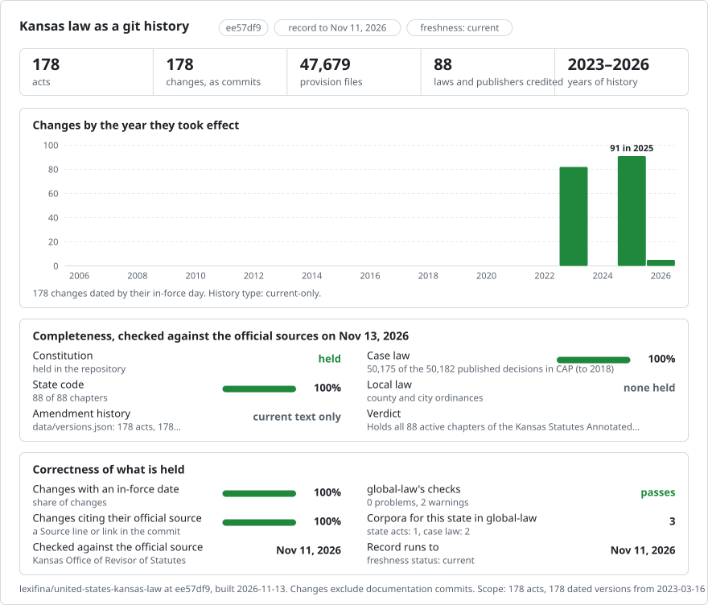

# Kansas: law history in git

<picture>
<source media="(prefers-color-scheme: dark)" srcset="data/effort-dark.svg">

</picture>

Kansas law from the Office of Revisor of Statutes and the Secretary of State. Part of [lexifina/global-law](https://github.com/lexifina/global-law).

## Coverage

This repository contains 91 current-text records from the Revisor's 2025 edition (the Constitution and the K.S.A. chapter records), plus 87 as-enacted session-law records: 2023 chapters 1–82 and 2026 chapters 1–5. The remaining session-law records are not included. This is not a complete history and does not incorporate the 2026 acts into the K.S.A. chapter texts.

| Folder | Act | Versions | History |
| --- | --- | ---: | --- |
| `constitution/` | Constitution of the State of Kansas | 1 | Current text; 2025 edition |
| `chapter-21-criminal-code/` | K.S.A. Chapter 21, Articles 51 to 99: Kansas Criminal Code and related crimes provisions | 1 | Current text; 2025 edition |
| `chapter-17-corporations/` | K.S.A. Chapter 17, Articles 60 to 72: Kansas General Corporation Code and related provisions | 1 | Current text; 2025 edition |
| `chapter-10-bonds-and-warrants/` | K.S.A. Chapter 10: Bonds and Warrants | 1 | Current text; 2025 edition |
| `chapter-11-census/` | K.S.A. Chapter 11: Census | 1 | Current text; 2025 edition |
| `chapter-12-cities-and-municipalities/` | K.S.A. Chapter 12: Cities and Municipalities | 1 | Current text; 2025 edition |
| `chapter-13-cities-of-the-first-class/` | K.S.A. Chapter 13: Cities of the First Class | 1 | Current text; 2025 edition |
| `chapter-14-cities-of-the-second-class/` | K.S.A. Chapter 14: Cities of the Second Class | 1 | Current text; 2025 edition |
| `chapter-15-cities-of-the-third-class/` | K.S.A. Chapter 15: Cities of the Third Class | 1 | Current text; 2025 edition |
| `chapter-16-contracts-and-promises/` | K.S.A. Chapter 16: Contracts and Promises | 1 | Current text; 2025 edition |
| `chapter-16a-consumer-credit-code/` | K.S.A. Chapter 16A: Consumer Credit Code | 1 | Current text; 2025 edition |
| `chapter-17-other-articles/` | K.S.A. Chapter 17: Corporations (articles not in the first build) | 1 | Current text; 2025 edition |
| `chapter-18-counties/` | K.S.A. Chapter 18: Counties | 1 | Current text; 2025 edition |
| `chapter-19-counties-and-county-officers/` | K.S.A. Chapter 19: Counties and County Officers | 1 | Current text; 2025 edition |
| `chapter-20-courts/` | K.S.A. Chapter 20: Courts | 1 | Current text; 2025 edition |
| `chapter-21-other-articles/` | K.S.A. Chapter 21: Crimes and Punishments (articles not in the first build) | 1 | Current text; 2025 edition |
| `chapter-22-criminal-procedure/` | K.S.A. Chapter 22: Criminal Procedure | 1 | Current text; 2025 edition |
| `chapter-22a-district-officers-and-employees/` | K.S.A. Chapter 22A: District Officers and Employees | 1 | Current text; 2025 edition |
| `chapter-23-kansas-family-law-code-revised/` | K.S.A. Chapter 23: Kansas Family Law Code-Revised | 1 | Current text; 2025 edition |
| `chapter-24-drainage-and-levees/` | K.S.A. Chapter 24: Drainage and Levees | 1 | Current text; 2025 edition |
| `chapter-25-elections/` | K.S.A. Chapter 25: Elections | 1 | Current text; 2025 edition |
| `chapter-26-eminent-domain/` | K.S.A. Chapter 26: Eminent Domain | 1 | Current text; 2025 edition |
| `chapter-26a-engineers/` | K.S.A. Chapter 26A: Engineers | 1 | Current text; 2025 edition |
| `chapter-27-federal-jurisdiction/` | K.S.A. Chapter 27: Federal Jurisdiction | 1 | Current text; 2025 edition |
| `chapter-28-fees-and-salaries/` | K.S.A. Chapter 28: Fees and Salaries | 1 | Current text; 2025 edition |
| `chapter-29-fences/` | K.S.A. Chapter 29: Fences | 1 | Current text; 2025 edition |
| `chapter-30-ferries/` | K.S.A. Chapter 30: Ferries | 1 | Current text; 2025 edition |
| `chapter-31-fire-protection/` | K.S.A. Chapter 31: Fire Protection | 1 | Current text; 2025 edition |
| `chapter-32-wildlife-parks-and-recreation/` | K.S.A. Chapter 32: Wildlife, Parks and Recreation | 1 | Current text; 2025 edition |
| `chapter-33-statute-of-frauds-fraudulent-conveyances/` | K.S.A. Chapter 33: Statute of Frauds; Fraudulent Conveyances | 1 | Current text; 2025 edition |
| `chapter-34-grain-and-forage/` | K.S.A. Chapter 34: Grain and Forage | 1 | Current text; 2025 edition |
| `chapter-35-holidays-and-days-of-commemoration/` | K.S.A. Chapter 35: Holidays and Days of Commemoration | 1 | Current text; 2025 edition |
| `chapter-36-hotels-lodginghouses-and-restaurants/` | K.S.A. Chapter 36: Hotels, Lodginghouses and Restaurants | 1 | Current text; 2025 edition |
| `chapter-37-impeachment/` | K.S.A. Chapter 37: Impeachment | 1 | Current text; 2025 edition |
| `chapter-38-minors/` | K.S.A. Chapter 38: Minors | 1 | Current text; 2025 edition |
| `chapter-39-dependent-persons-and-persons-with-disab/` | K.S.A. Chapter 39: Dependent Persons and Persons With Disabilities; Social Welfare | 1 | Current text; 2025 edition |
| `chapter-40-insurance/` | K.S.A. Chapter 40: Insurance | 1 | Current text; 2025 edition |
| `chapter-41-intoxicating-liquors-and-beverages/` | K.S.A. Chapter 41: Intoxicating Liquors and Beverages | 1 | Current text; 2025 edition |
| `chapter-42-irrigation/` | K.S.A. Chapter 42: Irrigation | 1 | Current text; 2025 edition |
| `chapter-43-jurors/` | K.S.A. Chapter 43: Jurors | 1 | Current text; 2025 edition |
| `chapter-44-labor-and-industries/` | K.S.A. Chapter 44: Labor and Industries | 1 | Current text; 2025 edition |
| `chapter-45-public-records-documents-and-information/` | K.S.A. Chapter 45: Public Records, Documents and Information | 1 | Current text; 2025 edition |
| `chapter-46-legislature/` | K.S.A. Chapter 46: Legislature | 1 | Current text; 2025 edition |
| `chapter-47-livestock-and-domestic-animals/` | K.S.A. Chapter 47: Livestock and Domestic Animals | 1 | Current text; 2025 edition |
| `chapter-48-militia-defense-and-public-safety/` | K.S.A. Chapter 48: Militia, Defense and Public Safety | 1 | Current text; 2025 edition |
| `chapter-49-mines-and-mining/` | K.S.A. Chapter 49: Mines and Mining | 1 | Current text; 2025 edition |
| `chapter-50-unfair-trade-and-consumer-protection/` | K.S.A. Chapter 50: Unfair Trade and Consumer Protection | 1 | Current text; 2025 edition |
| `chapter-51-motion-pictures/` | K.S.A. Chapter 51: Motion Pictures | 1 | Current text; 2025 edition |
| `chapter-52-negotiable-instruments/` | K.S.A. Chapter 52: Negotiable Instruments | 1 | Current text; 2025 edition |
| `chapter-53-notaries-public-and-commissioners/` | K.S.A. Chapter 53: Notaries Public and Commissioners | 1 | Current text; 2025 edition |
| `chapter-54-oaths-and-affirmations/` | K.S.A. Chapter 54: Oaths and Affirmations | 1 | Current text; 2025 edition |
| `chapter-55-oil-and-gas/` | K.S.A. Chapter 55: Oil and Gas | 1 | Current text; 2025 edition |
| `chapter-56-partnerships/` | K.S.A. Chapter 56: Partnerships | 1 | Current text; 2025 edition |
| `chapter-56a-kansas-uniform-partnership-act/` | K.S.A. Chapter 56A: Kansas Uniform Partnership Act | 1 | Current text; 2025 edition |
| `chapter-57-patent-rights-and-copyrights/` | K.S.A. Chapter 57: Patent Rights and Copyrights | 1 | Current text; 2025 edition |
| `chapter-58-personal-and-real-property/` | K.S.A. Chapter 58: Personal and Real Property | 1 | Current text; 2025 edition |
| `chapter-58a-kansas-uniform-trust-code/` | K.S.A. Chapter 58A: Kansas Uniform Trust Code | 1 | Current text; 2025 edition |
| `chapter-59-probate-code/` | K.S.A. Chapter 59: Probate Code | 1 | Current text; 2025 edition |
| `chapter-60-procedure-civil/` | K.S.A. Chapter 60: Procedure, Civil | 1 | Current text; 2025 edition |
| `chapter-61-procedure-civil-for-limited-actions/` | K.S.A. Chapter 61: Procedure, Civil, for Limited Actions | 1 | Current text; 2025 edition |
| `chapter-64-publications-bibliography-and-calendar/` | K.S.A. Chapter 64: Publications, Bibliography and Calendar | 1 | Current text; 2025 edition |
| `chapter-65-public-health/` | K.S.A. Chapter 65: Public Health | 1 | Current text; 2025 edition |
| `chapter-66-public-utilities/` | K.S.A. Chapter 66: Public Utilities | 1 | Current text; 2025 edition |
| `chapter-68-roads-and-bridges/` | K.S.A. Chapter 68: Roads and Bridges | 1 | Current text; 2025 edition |
| `chapter-69-sabbath/` | K.S.A. Chapter 69: Sabbath | 1 | Current text; 2025 edition |
| `chapter-70-salvage/` | K.S.A. Chapter 70: Salvage | 1 | Current text; 2025 edition |
| `chapter-70a-sand-and-gravel/` | K.S.A. Chapter 70A: Sand and Gravel | 1 | Current text; 2025 edition |
| `chapter-71-schools-community-colleges/` | K.S.A. Chapter 71: Schools—Community Colleges | 1 | Current text; 2025 edition |
| `chapter-72-schools/` | K.S.A. Chapter 72: Schools | 1 | Current text; 2025 edition |
| `chapter-73-soldiers-sailors-and-patriotic-emblems/` | K.S.A. Chapter 73: Soldiers, Sailors and Patriotic Emblems | 1 | Current text; 2025 edition |
| `chapter-74-state-boards-commissions-and-authorities/` | K.S.A. Chapter 74: State Boards, Commissions and Authorities | 1 | Current text; 2025 edition |
| `chapter-1-accountants-certified-public/` | K.S.A. Chapter 1: Accountants; Certified Public | 1 | Current text; 2025 edition |
| `chapter-2-agriculture/` | K.S.A. Chapter 2: Agriculture | 1 | Current text; 2025 edition |
| `chapter-3-aircraft-and-airfields/` | K.S.A. Chapter 3: Aircraft and Airfields | 1 | Current text; 2025 edition |
| `chapter-4-apportionment/` | K.S.A. Chapter 4: Apportionment | 1 | Current text; 2025 edition |
| `chapter-5-arbitration-and-award/` | K.S.A. Chapter 5: Arbitration and Award | 1 | Current text; 2025 edition |
| `chapter-6-architects/` | K.S.A. Chapter 6: Architects | 1 | Current text; 2025 edition |
| `chapter-7-attorneys-at-law/` | K.S.A. Chapter 7: Attorneys At Law | 1 | Current text; 2025 edition |
| `chapter-8-automobiles-and-other-vehicles/` | K.S.A. Chapter 8: Automobiles and Other Vehicles | 1 | Current text; 2025 edition |
| `chapter-9-banks-and-banking-trust-companies/` | K.S.A. Chapter 9: Banks and Banking; Trust Companies | 1 | Current text; 2025 edition |
| `chapter-75-state-departments-public-officers-and-em/` | K.S.A. Chapter 75: State Departments; Public Officers and Employees | 1 | Current text; 2025 edition |
| `chapter-76-state-institutions-and-agencies-historic/` | K.S.A. Chapter 76: State Institutions and Agencies; Historical Property | 1 | Current text; 2025 edition |
| `chapter-77-statutes-administrative-rules-and-regula/` | K.S.A. Chapter 77: Statutes; Administrative Rules and Regulations and Procedure | 1 | Current text; 2025 edition |
| `chapter-78-suretyship/` | K.S.A. Chapter 78: Suretyship | 1 | Current text; 2025 edition |
| `chapter-79-taxation/` | K.S.A. Chapter 79: Taxation | 1 | Current text; 2025 edition |
| `chapter-80-townships-and-township-officers/` | K.S.A. Chapter 80: Townships and Township Officers | 1 | Current text; 2025 edition |
| `chapter-81-trademarks-and-service-marks/` | K.S.A. Chapter 81: Trademarks and Service Marks | 1 | Current text; 2025 edition |
| `chapter-82-warehouses/` | K.S.A. Chapter 82: Warehouses | 1 | Current text; 2025 edition |
| `chapter-82a-waters-and-watercourses/` | K.S.A. Chapter 82A: Waters and Watercourses | 1 | Current text; 2025 edition |
| `chapter-83-weights-and-measures/` | K.S.A. Chapter 83: Weights and Measures | 1 | Current text; 2025 edition |
| `chapter-84-uniform-commercial-code/` | K.S.A. Chapter 84: Uniform Commercial Code | 1 | Current text; 2025 edition |
| `session-law-2023-chapter-001/` | Kansas Session Laws 2023, Chapter 1: Senate Bill No. 11 | 1 | As enacted; whole act |
| `session-law-2023-chapter-002/` | Kansas Session Laws 2023, Chapter 2: Senate Bill No. 39 | 1 | As enacted; whole act |
| `session-law-2023-chapter-003/` | Kansas Session Laws 2023, Chapter 3: Senate Bill No. 24 | 1 | As enacted; whole act |
| `session-law-2023-chapter-004/` | Kansas Session Laws 2023, Chapter 4: House Bill No. 2262 | 1 | As enacted; whole act |
| `session-law-2023-chapter-005/` | Kansas Session Laws 2023, Chapter 5: House Bill No. 2197 | 1 | As enacted; whole act |
| `session-law-2023-chapter-006/` | Kansas Session Laws 2023, Chapter 6: House Bill No. 2092 | 1 | As enacted; whole act |
| `session-law-2023-chapter-007/` | Kansas Session Laws 2023, Chapter 7: House Bill No. 2332 | 1 | As enacted; whole act |
| `session-law-2023-chapter-008/` | Kansas Session Laws 2023, Chapter 8: Senate Bill No. 3 | 1 | As enacted; whole act |
| `session-law-2023-chapter-009/` | Kansas Session Laws 2023, Chapter 9: Senate Bill No. 114 | 1 | As enacted; whole act |
| `session-law-2023-chapter-010/` | Kansas Session Laws 2023, Chapter 10: House Bill No. 2082 | 1 | As enacted; whole act |
| `session-law-2023-chapter-011/` | Kansas Session Laws 2023, Chapter 11: House Bill No. 2080 | 1 | As enacted; whole act |
| `session-law-2023-chapter-012/` | Kansas Session Laws 2023, Chapter 12: House Bill No. 2226 | 1 | As enacted; whole act |
| `session-law-2023-chapter-013/` | Kansas Session Laws 2023, Chapter 13: House Bill No. 2238 | 1 | As enacted; whole act |
| `session-law-2023-chapter-014/` | Kansas Session Laws 2023, Chapter 14: Senate Bill No. 120 | 1 | As enacted; whole act |
| `session-law-2023-chapter-015/` | Kansas Session Laws 2023, Chapter 15: Substitute for House Bill No. 2121 | 1 | As enacted; whole act |
| `session-law-2023-chapter-016/` | Kansas Session Laws 2023, Chapter 16: House Bill No. 2240 | 1 | As enacted; whole act |
| `session-law-2023-chapter-017/` | Kansas Session Laws 2023, Chapter 17: House Bill No. 2288 | 1 | As enacted; whole act |
| `session-law-2023-chapter-018/` | Kansas Session Laws 2023, Chapter 18: House Bill No. 2269 | 1 | As enacted; whole act |
| `session-law-2023-chapter-019/` | Kansas Session Laws 2023, Chapter 19: Senate Bill No. 144 | 1 | As enacted; whole act |
| `session-law-2023-chapter-020/` | Kansas Session Laws 2023, Chapter 20: Senate Bill No. 49 | 1 | As enacted; whole act |
| `session-law-2023-chapter-021/` | Kansas Session Laws 2023, Chapter 21: House Bill No. 2114 | 1 | As enacted; whole act |
| `session-law-2023-chapter-022/` | Kansas Session Laws 2023, Chapter 22: House Bill No. 2225 | 1 | As enacted; whole act |
| `session-law-2023-chapter-023/` | Kansas Session Laws 2023, Chapter 23: House Substitute for Senate Bill No. 208 | 1 | As enacted; whole act |
| `session-law-2023-chapter-024/` | Kansas Session Laws 2023, Chapter 24: House Bill No. 2087 | 1 | As enacted; whole act |
| `session-law-2023-chapter-025/` | Kansas Session Laws 2023, Chapter 25: House Bill No. 2395 | 1 | As enacted; whole act |
| `session-law-2023-chapter-026/` | Kansas Session Laws 2023, Chapter 26: House Bill No. 2290 | 1 | As enacted; whole act |
| `session-law-2023-chapter-027/` | Kansas Session Laws 2023, Chapter 27: Senate Substitute for House Bill No. 2016 | 1 | As enacted; whole act |
| `session-law-2023-chapter-028/` | Kansas Session Laws 2023, Chapter 28: Senate Substitute for House Bill No. 2127 | 1 | As enacted; whole act |
| `session-law-2023-chapter-029/` | Kansas Session Laws 2023, Chapter 29: House Bill No. 2323 | 1 | As enacted; whole act |
| `session-law-2023-chapter-030/` | Kansas Session Laws 2023, Chapter 30: House Bill No. 2160 | 1 | As enacted; whole act |
| `session-law-2023-chapter-031/` | Kansas Session Laws 2023, Chapter 31: House Bill No. 2326 | 1 | As enacted; whole act |
| `session-law-2023-chapter-032/` | Kansas Session Laws 2023, Chapter 32: House Bill No. 2214 | 1 | As enacted; whole act |
| `session-law-2023-chapter-033/` | Kansas Session Laws 2023, Chapter 33: House Bill No. 2322 | 1 | As enacted; whole act |
| `session-law-2023-chapter-034/` | Kansas Session Laws 2023, Chapter 34: House Bill No. 2216 | 1 | As enacted; whole act |
| `session-law-2023-chapter-035/` | Kansas Session Laws 2023, Chapter 35: House Bill No. 2336 | 1 | As enacted; whole act |
| `session-law-2023-chapter-036/` | Kansas Session Laws 2023, Chapter 36: House Bill No. 2042 | 1 | As enacted; whole act |
| `session-law-2023-chapter-037/` | Kansas Session Laws 2023, Chapter 37: House Bill No. 2015 | 1 | As enacted; whole act |
| `session-law-2023-chapter-038/` | Kansas Session Laws 2023, Chapter 38: House Bill No. 2020 | 1 | As enacted; whole act |
| `session-law-2023-chapter-039/` | Kansas Session Laws 2023, Chapter 39: House Bill No. 2065 | 1 | As enacted; whole act |
| `session-law-2023-chapter-040/` | Kansas Session Laws 2023, Chapter 40: House Bill No. 2125 | 1 | As enacted; whole act |
| `session-law-2023-chapter-041/` | Kansas Session Laws 2023, Chapter 41: Senate Bill No. 119 | 1 | As enacted; whole act |
| `session-law-2023-chapter-042/` | Kansas Session Laws 2023, Chapter 42: Senate Bill No. 85 | 1 | As enacted; whole act |
| `session-law-2023-chapter-043/` | Kansas Session Laws 2023, Chapter 43: House Bill No. 2039 | 1 | As enacted; whole act |
| `session-law-2023-chapter-044/` | Kansas Session Laws 2023, Chapter 44: Senate Substitute for House Bill No. 2058 | 1 | As enacted; whole act |
| `session-law-2023-chapter-045/` | Kansas Session Laws 2023, Chapter 45: Senate Substitute for House Bill No. 2170 | 1 | As enacted; whole act |
| `session-law-2023-chapter-046/` | Kansas Session Laws 2023, Chapter 46: House Bill No. 2196 | 1 | As enacted; whole act |
| `session-law-2023-chapter-047/` | Kansas Session Laws 2023, Chapter 47: House Bill No. 2173 | 1 | As enacted; whole act |
| `session-law-2023-chapter-048/` | Kansas Session Laws 2023, Chapter 48: House Bill No. 2172 | 1 | As enacted; whole act |
| `session-law-2023-chapter-049/` | Kansas Session Laws 2023, Chapter 49: House Bill No. 2090 | 1 | As enacted; whole act |
| `session-law-2023-chapter-050/` | Kansas Session Laws 2023, Chapter 50: House Bill No. 2093 | 1 | As enacted; whole act |
| `session-law-2023-chapter-051/` | Kansas Session Laws 2023, Chapter 51: House Bill No. 2131 | 1 | As enacted; whole act |
| `session-law-2023-chapter-052/` | Kansas Session Laws 2023, Chapter 52: House Bill No. 2147 | 1 | As enacted; whole act |
| `session-law-2023-chapter-053/` | Kansas Session Laws 2023, Chapter 53: House Bill No. 2335 | 1 | As enacted; whole act |
| `session-law-2023-chapter-054/` | Kansas Session Laws 2023, Chapter 54: Senate Bill No. 44 | 1 | As enacted; whole act |
| `session-law-2023-chapter-055/` | Kansas Session Laws 2023, Chapter 55: Senate Bill No. 75 | 1 | As enacted; whole act |
| `session-law-2023-chapter-056/` | Kansas Session Laws 2023, Chapter 56: House Bill No. 2279 | 1 | As enacted; whole act |
| `session-law-2023-chapter-057/` | Kansas Session Laws 2023, Chapter 57: House Substitute for Senate Bill No. 42 | 1 | As enacted; whole act |
| `session-law-2023-chapter-058/` | Kansas Session Laws 2023, Chapter 58: House Bill No. 2014 | 1 | As enacted; whole act |
| `session-law-2023-chapter-059/` | Kansas Session Laws 2023, Chapter 59: Senate Substitute for House Bill No. 2302 | 1 | As enacted; whole act |
| `session-law-2023-chapter-060/` | Kansas Session Laws 2023, Chapter 60: Senate Bill No. 132 | 1 | As enacted; whole act |
| `session-law-2023-chapter-061/` | Kansas Session Laws 2023, Chapter 61: Senate Bill No. 66 | 1 | As enacted; whole act |
| `session-law-2023-chapter-062/` | Kansas Session Laws 2023, Chapter 62: House Substitute for Senate Bill No. 116 | 1 | As enacted; whole act |
| `session-law-2023-chapter-063/` | Kansas Session Laws 2023, Chapter 63: Senate Bill No. 189 | 1 | As enacted; whole act |
| `session-law-2023-chapter-064/` | Kansas Session Laws 2023, Chapter 64: Senate Bill No. 123 | 1 | As enacted; whole act |
| `session-law-2023-chapter-065/` | Kansas Session Laws 2023, Chapter 65: Senate Bill No. 243 | 1 | As enacted; whole act |
| `session-law-2023-chapter-066/` | Kansas Session Laws 2023, Chapter 66: House Substitute for Senate Bill No. 244 | 1 | As enacted; whole act |
| `session-law-2023-chapter-067/` | Kansas Session Laws 2023, Chapter 67: Senate Substitute for House Bill No. 2053 | 1 | As enacted; whole act |
| `session-law-2023-chapter-068/` | Kansas Session Laws 2023, Chapter 68: Senate Bill No. 17 | 1 | As enacted; whole act |
| `session-law-2023-chapter-069/` | Kansas Session Laws 2023, Chapter 69: House Substitute for Senate Bill No. 229 | 1 | As enacted; whole act |
| `session-law-2023-chapter-070/` | Kansas Session Laws 2023, Chapter 70: House Bill No. 2024 | 1 | As enacted; whole act |
| `session-law-2023-chapter-071/` | Kansas Session Laws 2023, Chapter 71: House Bill No. 2059 | 1 | As enacted; whole act |
| `session-law-2023-chapter-072/` | Kansas Session Laws 2023, Chapter 72: House Bill No. 2298 | 1 | As enacted; whole act |
| `session-law-2023-chapter-073/` | Kansas Session Laws 2023, Chapter 73: House Bill No. 2346 | 1 | As enacted; whole act |
| `session-law-2023-chapter-074/` | Kansas Session Laws 2023, Chapter 74: House Bill No. 2027 | 1 | As enacted; whole act |
| `session-law-2023-chapter-075/` | Kansas Session Laws 2023, Chapter 75: House Bill No. 2019 | 1 | As enacted; whole act |
| `session-law-2023-chapter-076/` | Kansas Session Laws 2023, Chapter 76: Senate Bill No. 205 | 1 | As enacted; whole act |
| `session-law-2023-chapter-077/` | Kansas Session Laws 2023, Chapter 77: House Bill No. 2130 | 1 | As enacted; whole act |
| `session-law-2023-chapter-078/` | Kansas Session Laws 2023, Chapter 78: Senate Bill No. 217 | 1 | As enacted; whole act |
| `session-law-2023-chapter-079/` | Kansas Session Laws 2023, Chapter 79: Senate Bill No. 221 | 1 | As enacted; whole act |
| `session-law-2023-chapter-080/` | Kansas Session Laws 2023, Chapter 80: House Bill No. 2100 | 1 | As enacted; whole act |
| `session-law-2023-chapter-081/` | Kansas Session Laws 2023, Chapter 81: House Bill No. 2292 | 1 | As enacted; whole act |
| `session-law-2023-chapter-082/` | Kansas Session Laws 2023, Chapter 82: House Bill No. 2184 | 1 | As enacted; whole act |
| `session-law-2026-chapter-001/` | Kansas Session Laws 2026, Chapter 1: House Bill No. 2183* | 1 | As enacted; whole act |
| `session-law-2026-chapter-002/` | Kansas Session Laws 2026, Chapter 2: House Bill No. 2347 (Amended by Chapter 157) | 1 | As enacted; whole act |
| `session-law-2026-chapter-003/` | Kansas Session Laws 2026, Chapter 3: House Substitute for Senate Bill No. 244 | 1 | As enacted; whole act |
| `session-law-2026-chapter-004/` | Kansas Session Laws 2026, Chapter 4: House Bill No. 2274 | 1 | As enacted; whole act |
| `session-law-2026-chapter-005/` | Kansas Session Laws 2026, Chapter 5: House Bill No. 2223 (Amended by Chapter 155) | 1 | As enacted; whole act |

## Sources and dates

The [Revisor's K.S.A. index](https://ksrevisor.gov/ksa.html) describes its edition as including amendments and new laws enacted during the 2025 session. The [Constitution index](https://ksrevisor.gov/kanconst.html) states that its edition includes new and revised provisions enacted as of 1 July 2025. The existing chapter records retain their 1 July 2025 edition dates; these are current-text snapshots, not reconstructions of each provision's historical commencement.

The [Secretary of State session-law table](https://www.sos.ks.gov/publications/session-laws.html) and [archive](https://www.sos.ks.gov/publications/session-laws-archive.html) give the initial effective date of each session act. Publication in the statute book is 1 July; Kansas Register dates are those recorded in the table. Approval dates are retained when supplied. Each session-law record includes the act as enacted, its commencement clauses and any section-specific dates. Later amendments are not consolidated.

## Text and limitations

K.S.A. records use one file per section. Each session-law record uses a single whole-act file, preserving all source paragraphs and textual tables. Legislative deletion marks are retained as `del` elements and insertion marks as `ins` elements. Publisher chapter headings, approval lines and editorial amendment headings are retained. Concurrent resolutions and governor messages are outside this session-law supplement.

The current-text records omit case annotations, history lines and eliminated Constitution provisions with no body. The session-law supplement includes historical enactments, including appropriation measures; it does not assert that all their provisions remain operative today. Initial act-effective dates do not replace section-specific commencement or applicability clauses.

## Verification and authorship

The shared repository checker verifies provision files and In-force trailers. Session-law texts are also compared with the official HTML through an independent text parser, including textual tables. Repeated builds are deterministic. Source URLs and hashes accompany the version records.

Current-text starts name the official publisher as author. As-enacted session-law starts name the enacting law. Lexifina is the committer. Legislative text is reproduced from the official sources under the government edicts doctrine; repository arrangement and tools are licensed as stated in LICENSE.
